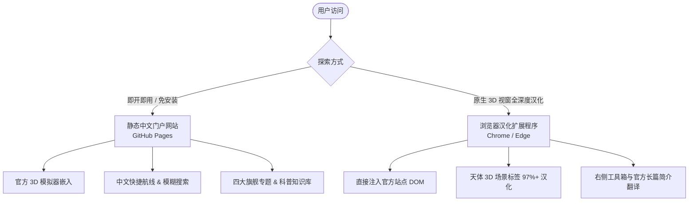

# 深空之眸 · NASA Eyes 中文观测站 (Eyes Solar System)

> **基于 NASA/JPL 官方 Eyes on the Solar System 实时 3D 动力学模型，专为中文用户打造的太阳系探索门户与科普观测站。**  
> 线上体验地址：[https://selflove9417.github.io/eyes-solar-system/](https://selflove9417.github.io/eyes-solar-system/)

---

## 一、项目愿景与定位

**深空之眸（Eyes Solar System）** 致力于消除语言与交互门槛，让每一位天文学爱好者与公众能够零阻碍地探索太阳系的壮丽图景。

- **官方 3D 动力学驱动**：天体轨道运行、探测器航迹演化与行星几何姿态直接由 [NASA/JPL Eyes on the Solar System](https://eyes.nasa.gov/apps/solar-system/#/home) 客户端 WebGL 实时解算驱动。
- **独立非官方科普声明**：本项目为独立开源科普项目，与 NASA 及 JPL 无任何官方隶属或商业背书关系。本项目严格遵守知识产权与安全规范，不篡改、不破解其任何专有程序与物理模型。
- **严谨科学审校标准**：杜绝夸大与虚假包装，全站数据均可追溯至 NASA、JPL、IAU、ESA 等权威机构的原始科学公报。

---

## 二、双轨架构：静态门户 + 浏览器扩展

由于现代浏览器的**跨域同源安全策略（SOP）**，父页面无法直接穿透读取或修改外部嵌入 iframe 内部的 DOM 内容。本项目采用两条互补的技术路径实现最佳中文体验：



| 载体 | 形态 | 核心能力与汉化范围 | 部署与使用门槛 |
| :--- | :--- | :--- | :--- |
| **中文门户网站**（本站） | 纯静态 Web 站点 | 全站 UI、中文侧栏搜索、快捷航线直达、新手引导路线、四大旗舰专题、天体/任务知识库 | **零门槛**，任何浏览器直接打开即用，支持手机与桌面端 |
| **浏览器汉化扩展** | Chrome / Edge Extension | 深入官方站点内部，汉化 3D 场景中的天体悬浮标签、详情面板、工具栏、菜单与官方科学简介 | 本地“加载已解压的扩展程序”，专为需要原生全界面中文的用户设计 |

---

## 三、核心功能与亮点

### 1. 3D 太阳系实时漫游 (`explore.html`)
- **智能加载指示与超时自愈**：引入前置加载遮罩与 18 秒服务响应超时恢复卡片；彻底解决同页内天体 Hash 切换不触发原生 `iframe.onload` 导致的遮罩误报死锁问题。
- **中文模糊联想搜索**：支持输入天体、行星、航天器中文名、英文名或数字代号，实时呈现多维度匹配结果及置信度徽标。
- **三大新手探索引导路线**：
  - 🪐 **环系巡航**：直达土星与 28 万公里宏伟冰环，特写卡西尼环缝；
  - 🔴 **火星搜奇**：探访红色星球，直达毅力号与好奇号火星表面巡视器模型与着陆区；
  - 🚀 **星际边界**：俯瞰突破日球层顶、疾驰在 250+ 亿公里深空的旅行者 1 号。
- **一键全景复位**：醒目的【🌌 返回太阳系全景 (全览模式)】控制，一键指挥 3D 视口恢复全局鸟瞰，并补齐前进后退 `hashchange` 状态双向同步。

### 2. 四大旗舰特写专题
- **火星：红色星球与漫游车先驱 (`mars.html`)**：
  - 严格区分火星自转周期（24h 37m 22s）与火星太阳日 Sol（24h 39m 35s）；
  - 科学解释地火距离几何变动，客观呈现火卫成因双假说；
  - 正确区分地表巡视器与轨道探测器，规范三维模型展示。
- **韦伯太空望远镜 JWST：窥见宇宙深空曙光 (`jwst.html`)**：
  - 深入解析日地 L2 拉格朗日点晕轨道动力学；
  - 详述五层遮阳板被动辐射冷却（<40K）与 MIRI 闭环机械氦脉冲管制冷（7K）双区温控机理。
- **土星与环系奇观 (`saturn.html`)**：
  - 权威更新：明确呈现**截至 2026 年 8 月 IAU/NASA 认证的 293 颗天然卫星**，注明动态发现口径；
  - 揭示跨越 28 万公里但厚度仅 10~100 米的极薄主环比例。
- **旅行者 1 号：突破星际边界的孤勇信使 (`voyager-1.html`)**：
  - 阐述 172+ AU（250+ 亿公里）与单程近 24 小时光速延迟；
  - 具备实时接口 `AbortController` 8 秒超时保护与优雅数据降级机制。

### 3. 全面规范的中文知识库
- **天体中文库 (`bodies.html`)**：八大行星、矮行星、主要卫星的规范审定中文名，逐条附带官方数据来源。
- **航天任务库 (`missions.html`)**：人类 40 余项重大深空探测任务档案与在轨/退役状态梳理。
- **中英天文学术语对照 (`glossary.html`)**：收录 **719 个 NASA 官方实体**，其中 **392 个已建立规范/通用中文对照**，未收录条目严格保留官方英文。

### 4. 移动端与无障碍全面优化
- **移动端优先视口适配**：针对 390px 典型手机竖屏，3D 视口置顶优先呈现，天体目录折叠为交互抽屉；
- **排版防溢出设计**：探索引导卡片弹性折行，全站数据表格统一采用 `.table-container` 横向平滑滚动；
- **全方位无障碍保障**：满足 WCAG 2.1 AA 对比度、所有可交互元素提供清晰 `:focus-visible` 焦点环，触控热区 $\ge 44\text{px}$，尊重系统的 `prefers-reduced-motion` 动效减弱偏好。
- **极简设计规范系统**：详见 [docs/DESIGN_SYSTEM.md](docs/DESIGN_SYSTEM.md)，沉淀了去盒子化、3D 为主角、单主动作、令牌间距阶梯与无障碍合规基准。

---

## 四、快速上手与本地运行

项目完全遵循现代 Web 标准，**无须任何前端编译或打包构建步骤，零第三方依赖**。

### 1. 本地启动服务

> ⚠️ **注意**：由于现代浏览器安全策略禁止通过 `file://` 直接跨域读取本地 JSON 数据文件，必须通过本地 HTTP 服务访问。

- **Windows 极速启动**：直接双击运行根目录下的 `start.cmd`（自动启动服务并调起默认浏览器）。
- **命令行启动**（使用 Node.js 自带模块）：
  ```bash
  node tools/serve.mjs . 8890
  # 访问 http://127.0.0.1:8890/
  ```

### 2. 自动化词条校验与代码规范

代码库配备严格的 CI 校验工具，防止出现中英文不匹配或未翻译乱码：

```bash
node tools/lint-zh.mjs
```
*检查项：确保中文库中的英文原文与 NASA 官方数据基准逐字一致；检查是否存在未知 ID 或字段中残留的非规范英文。*

### 3. 浏览器汉化扩展打包

```bash
node tools/pack-extension.mjs
```
打包输出至 `dist/eyes-zh-extension/` 目录。
- **Chrome / Edge 安装**：打开 `chrome://extensions` 或 `edge://extensions` ➔ 开启【开发者模式】 ➔ 点击【加载已解压的扩展程序】 ➔ 选择 `dist/eyes-zh-extension` 目录即可。

---

## 五、项目工程目录结构

```
e:\NASA/
├── index.html                   # 中文观测站门户首页（核心行动入口、四大旗舰卡片、全景板块）
├── explore.html                 # 3D 漫游核心页（官方 iframe、智能遮罩、中文搜索、引导路线）
├── mars.html                    # 旗舰专题：火星探索与表面巡视器
├── jwst.html                    # 旗舰专题：韦伯望远镜与 L2 轨道动力学
├── saturn.html                  # 旗舰专题：土星、293 颗卫星与环系奇观
├── voyager-1.html               # 旗舰专题：旅行者 1 号星际穿越与实时星历降级
├── bodies.html                  # 天体规范中文名称与官方简介知识库
├── missions.html                # 人类重大深空探测器与航天任务资料库
├── glossary.html                # 中英天文学术语与实体对照表（719实体 / 392对照）
├── guide.html                   # NASA Eyes 官方 3D 模拟器高阶操作技巧指南
├── about.html                   # 项目背景、数据来源追溯与非官方合规声明
├── extension.html               # 浏览器汉化扩展程序使用说明与离线包下载指引
│
├── docs/
│   ├── DESIGN_SYSTEM.md         # 极简设计规范系统与组件指南
│   └── technical-report.md      # 官方技术调查与取证复核报告
│
├── assets/
│   ├── css/main.css             # 全局设计规范：深空科技主题、响应式断点、无障碍与抽屉样式
│   └── js/site.js               # 共享数据层、动态微星空 Canvas、嵌入 URL 构造器
│
├── data/
│   ├── names.zh.json            # 官方实体 ID 到规范中文名对照（含译名依据等级）
│   ├── ui.zh.json               # 界面原生字符串英中映射表
│   ├── bodies.zh.json           # 官方天体中文简介与来源链接
│   ├── missions.zh.json         # 官方航天任务中文简介与来源链接
│   └── source/                  # 官方只读基准数据快照（entities.en.json / descriptions.en.json）
│
├── extension/                   # 汉化扩展程序源码（Manifest V3 + content.js）
├── tools/                       # 零依赖本地工程工具链
│   ├── serve.mjs                # 轻量静态 HTTP 服务器
│   ├── lint-zh.mjs              # 中文知识库自动化数据校验脚本
│   ├── run-all-tests.mjs        # 聚合测试套件运行器 (npm test)
│   └── pack-extension.mjs       # 扩展程序一键打包脚本
│
├── shots/                       # 官方视觉基线与验收截图 (44 张正式基线)
│   └── .tmp/                    # 本地测试产生的临时比对截图 (已被 .gitignore 忽略)
│
├── .github/workflows/deploy.yml # GitHub Actions 自动化静态发布流水线
└── README.md                    # 项目全景说明文档
```

### 本地测试与截图更新规范

运行全站 13 项自动化回归测试套件：
```bash
npm test
```
- **临时截图隔离**：测试默认将运行截图写入 `shots/.tmp/` 目录（已加入 `.gitignore`），避免污染 Git 工作区。
- **正式基线更新**：仅当需要刻意更新视觉验收基线时，为子脚本追加 `--update-shots` 参数（例如 `node tools/verify-phase4-qa.mjs --update-shots`），才会覆盖写入 `shots/` 根目录下的正式基准图。

---

## 六、科学数据口径与更新规则

1. **坚持动态数据口径标注**：天文学发现（如系外天体、行星卫星数目）随观测技术进步动态演化，全站凡涉及变动数据均明确注明统计时间点（例如“截至 2026 年 8 月统计”），杜绝将动态科学结论固化为永久定论。
2. **严谨区分工程实体系别**：严格区分地表巡视器（Rover）、轨道探测器（Orbiter）与深空飞越器（Flyby），不将模型外观展示等同于实时遥测位姿。
3. **数据文本与渲染逻辑分离**：所有翻译数据均集中于 `data/*.json`，页面逻辑不硬编码翻译字符串，确保数据唯一权威。

---

## 七、致谢与合规声明

- **天体动力学与 3D 渲染**：[NASA/JPL Eyes on the Solar System](https://eyes.nasa.gov/apps/solar-system/)  
- **天体星历与空间数据**：NASA Jet Propulsion Laboratory, California Institute of Technology  
- **开源许可证**：本项目自有网页与工具脚本采用 MIT 许可证开源。引用之 NASA 官方公开事实数据及英文描述属于公共领域或官方公开科学资料，著作权归原机构所有。
